# Nostradamus Quant Terminal (IHSG) — Skema Arsitektur Sistem & Spesifikasi Mesin Kuantitatif
**Dokumen Referensi Teknis untuk Quant System Reviewer & Audit Metodologi**

---

## 1. Ringkasan Eksekutif & Filosofi Rekayasa (*Engineering Philosophy*)

**Nostradamus Quant Terminal (IHSG)** adalah sistem *Institutional-Grade Quantitative Equity Screener*, *Multi-Method Fundamental Valuation Engine*, *Two-Sleeve Barbell HRP Portfolio Optimizer*, dan *Zero-Knowledge Cloud Portfolio Manager* yang dirancang khusus untuk mikrostruktur pasar modal Indonesia (**Bursa Efek Indonesia / IDX — 956+ Emiten**).

### Prinsip Desain Utama:
1. **Deterministic Single Source of Truth (SSOT)**: Seluruh angka valuasi, komponen bobot *ensemble*, skor keyakinan pra-penalti (`rawConvictionScore`) vs pasca-penalti (`finalConvictionScore`), hingga sinyal eksekusi (`primaryExecutionActionLabel`) dihitung secara deterministik oleh mesin TypeScript sebelum dikirim ke UI, laporan AI, maupun kanvas ekspor PDF/PNG.
2. **Point-in-Time & Forensic Data Lineage (P0 Guardrail)**: Setiap metrik fundamental dan makro melacak asal-usul datanya (`LIVE_YAHOO_API` / Worker, `USER_OVERRIDE`, `IDX_SNAPSHOT`, atau `CATALOG_SEED`) beserta usianya. Data *seed* yang belum terverifikasi otomatis dibatasi maksimal pada **Grade C (`C (SEED CAPPED)`, Skor $\le 64/100$)**.
3. **Sector-Aware Valuation Routing (P1 Guardrail)**: Menolak pendekatan *one-size-fits-all*. Emiten perbankan (`FINANCIALS_BANKING`) tidak dinilai menggunakan *EV/EBITDA*, *DER* korporasi, atau *GP/A* ritel, melainkan menggunakan *Damodaran Justified PBV*, *Ohlson Multi-Stage Residual Income*, dan *ROE vs Dynamic Cost of Equity ($K_e$)* berbasis kurva *Spot SBN*.
4. **Subordinated Tactical Overlay & Strict Risk Sizing (P2–P3 Guardrail)**: Sinyal *Statistical Arbitrage (Pairs Trading)* memiliki bobot **0%** terhadap Nilai Intrinsik Wajar dan disubordinasikan di bawah tesis fundamental utama. Ukuran posisi (*position sizing*) dikunci oleh batas minimum antara **Plafon $1/\beta$ & Volatilitas**, **Kas Riil Portofolio**, dan **Aturan Likuiditas $5\% \times \text{ADTV}_{20\text{D}}$**.

---

## 2. Skema Arsitektur Sistem (*End-to-End Pipeline Architecture*)

### 2.1. Diagram Alir Arsitektur Utama (Mermaid)

```mermaid
flowchart TD
    subgraph INGEST["1. DATA INGESTION & MULTI-TIER FETCHER LAYER"]
        A1["Cloudflare Worker / Express Proxy<br/>(Yahoo Finance v8 Quote, Chart & Fundamentals)"]
        A2["GitHub Actions Cron (3x/Hari BEI)<br/>(public/static-market-snapshot.json & fundamentals-snapshot.json)"]
        A3["11 Global Macro Indicators & SBN Yield Curve<br/>(SBN 1Y, 5Y, 10Y, USD/IDR, VIX, US10Y, DXY, Komoditas)"]
        A4["Manual Analyst Calibration & KSEI HSC Registry<br/>(User Override & Pengumuman Konsentrasi Top-10 BEI-KSEI)"]
    end

    subgraph P0["2. LAYER P0: FORENSIC DATA LINEAGE & SANITY ENGINE"]
        B1["RawTickerData Assembler & Unit Normalizer<br/>(IDR Penuh, Lot-100 BEI, Split Divisor 1:N)"]
        B2["Accounting Invariant & Cross-Check Gate<br/>(MktCap vs Px×Shares, NI vs EPS×Shares, Eq vs BVPS×Shares)"]
        B3["SBN Macro Freshness & Proxy Detector<br/>(Usia > 7 Hari / Proxy ^TNX ➔ +50 bps Ke Buffer & Penalti)"]
        B4["Data Lineage Integrity Classifier<br/>(INSTITUTIONAL_GRADE / DEGRADED_STALE / SEED_FALLBACK_CAPPED)"]
    end

    subgraph P05["3. LAYER P0.5: CORPORATE ACTION & TRUE TTM MIDDLEWARE"]
        C1["YTD-to-Discrete Quarter De-Cumulator<br/>(Q2=6M-Q1, Q3=9M-6M, Q4=FY-9M ➔ True 4Q TTM)"]
        C2["Anti-Naive Linear Annualization Blocker<br/>(Blokir 12/M × YTD jika deviasi > 20% atau Siklikal)"]
        C3["Dual-Confirmation Catalyst Interceptor<br/>(Syarat: Operating Profit YoY >= +20% DAN OCF/NI >= 0.85)"]
        C4["Anti-Double-Count Total Shareholder Yield<br/>(Forward Div Yield + Buyback Yield + Conditional Net Debt Paydown)"]
    end

    subgraph P1["4. LAYER P1: SECTOR ROUTER & 3-LEG DYNAMIC ENSEMBLE VALUATION"]
        D1["IDX-IC Sector Methodology Router (6 Rezim Sektor)<br/>(Banking | Cyclical | Infra | Consumer | Property | Tech)"]
        D2["Dynamic Cost of Equity (Ke) Engine<br/>(Blended Spot SBN Rf + Clamped Beta × ERP + Gov/Liq Premium)"]
        D3["3-Leg Dynamic Ensemble Weighter (ValuationLedger)<br/>(Leg 1: Sector Matrix | Leg 2: Multi-Stage RIM | Leg 3: EPV / Maintenance FCF)"]
        D4["Model Dispersion Penalty (CV > 35%) &<br/>Standalone Graham-Joeliardi Floor (Clamped <= 90% Ensemble)"]
    end

    subgraph P2["5. LAYER P2: 4-PILLAR SCORING, STAT-ARB OVERLAY & RISK SIZING"]
        E1["4-Pillar Raw Conviction Score (0–100)<br/>(30% Business Quality + 25% Balance Sheet + 25% Valuation + 20% OOS Quant)"]
        E2["Post-Penalty Deduction Ledger ➔ finalConvictionScore<br/>(Accrual + Dispersion + HSC KSEI + Stale Rf + Weak Moat + Seed Cap)"]
        E3["Subordinated Tactical Pair StatArb Overlay<br/>(0% Bobot Intrinsik · Cointegration Z-Score & Mean-Reversion Target)"]
        E4["Vol-Targeted 1/Beta Barbell Sizing & ATR/Vol Stop Loss<br/>(Tranche 1: 60% + Tranche 2: 40% · Capped by min[Kas Riil, 5% ADTV 20D])"]
    end

    subgraph P3["6. LAYER P3: SSOT EXECUTION THESIS, PORTFOLIO BUFFER & EXPORT"]
        F1["SSOT Execution Thesis Resolver (resolveExecutionThesis)<br/>(Sinkronisasi Grade, finalConvictionScore, MoS & Rekomendasi Aksi)"]
        F2["DeMiguel Multifactor Portfolio Optimizer & No-Trade Buffer<br/>(Keranjang 1 Defensive 55% + Keranjang 2 Alpha 45% · Buffer 25%/35%/40%)"]
        F3["Zero-Knowledge AES-256-GCM Vault & Ultra-HD PDF/PNG Exporter<br/>(PBKDF2 100k Iter + Raw Data Audit Strip Telemetry)"]
    end

    INGEST --> P0 --> P05 --> P1 --> P2 --> P3
```

---

### 2.2. Peta Modul Kode Sumber (*Codebase Module Map*)

| Modul / File | Peran Arsitektural & Tanggung Jawab Utama |
| :--- | :--- |
| `src/types/quant.ts` | Kontrak tipe data utama (`StockMetrics`, `JoeliardiOosEvaluation`, `RawTickerData`, `DataLineageReport`, `ValuationLedger`, `RiskSizingResult`). |
| `src/utils/dataLineageEngine.ts` | **Layer P0**: Audit *provenance* per-field (`LIVE_YAHOO_API`, `USER_OVERRIDE`, `IDX_SNAPSHOT`, `CATALOG_SEED`), usia kesegaran data, status kurva SBN 10Y, dan *Grade C Seed Cap*. |
| `src/utils/institutionalGuardrailsEngine.ts` | **Layer P0–P3 Guardrails**: Validasi *accounting invariant*, *2-Stage Residual Income*, *Maintenance Capex Override*, *Model Dispersion Penalty*, *Vol-Targeted Sizing*, dan `resolveExecutionThesis`. |
| `src/utils/corporateActionMiddleware.ts` | **Layer P0.5**: Dekumulasi kuartalan YTD ke TTM 4-kuartal murni, pemblokir *linear annualization*, *dual-confirmation catalyst*, dan normalisasi *stock split*. |
| `src/utils/tsyCalculator.ts` | **Layer P0.5**: Perhitungan *Total Shareholder Yield (TSY)* dan *Net Payout Yield (NPY)* dengan aturan *anti-double-counting* untuk perbankan & emiten ber-DER tinggi. |
| `src/utils/sectorMethodologyRouter.ts` | **Layer P1**: Pemetaan sektor IDX-IC ke 6 rezim metodologi valuasi beserta matriks bobot *3-Leg Ensemble* spesifik sektor. |
| `src/utils/valuationEngine.ts` | **Layer P1**: Mesin *Dynamic Cost of Equity ($K_e$)*, *Damodaran Justified PBV*, *Ohlson Multi-Stage RIM*, *Graham-Joeliardi Floor*, dan `ValuationLedger`. |
| `src/utils/quantEngine.ts` | **Core Orchestrator**: Mengintegrasikan seluruh layer P0–P3 dalam `evaluateJoeliardiOosFundamental()`, skor *DeMiguel 4-Factor (DMU)*, deteksi rezim IHSG, *Barbell HRP Allocator*, dan *Walk-Forward Backtest*. |
| `src/utils/liveMarketFetcher.ts` | **Data & AI Report Layer**: *Multi-tier market fetcher*, sanitasi berita RSS, dan generator laporan komite investasi (`buildDeepAnalyticalConvictionReport`) yang mengunci `finalConvictionScore`. |
| `src/utils/exportInspectorReport.ts` | **Presentation & Audit Export**: Renderer kanvas *Ultra-HD Retina (2400px)* untuk ekspor laporan PDF & PNG lengkap dengan *Footer Raw Data Audit Strip*. |
| `src/utils/securityVault.ts` | **Security Layer**: Enkripsi portofolio sisi klien *Zero-Knowledge* menggunakan `PBKDF2-SHA256` (100.000 iterasi) + `AES-256-GCM` + `FIPS 180-4 SHA-256 Scope Binding`. |

---

## 3. Layer P0: Forensic Data Lineage, Freshness & Sanity Audit Engine

Sebelum satu pun rumus valuasi dijalankan, data emiten harus melewati gerbang audit forensik di `dataLineageEngine.ts` dan `institutionalGuardrailsEngine.ts`.

### 3.1. Klasifikasi Provenance & Kesegaran Per-Field
Setiap variabel input kritis (`lastPrice`, `sharesOutstanding`, `revenueTTMIdr`, `netIncomeTTMIdr`, `operatingCashFlowTTMIdr`, `equityAttributableIdr`, `totalAssetsIdr`, `totalDebtIdr`, `capexTTMIdr`, `adtv20dIdr`) diberi tag metadata:
- **Source**:
  - `LIVE_YAHOO_API` (ditampilkan sebagai `DATA: WORKER` / `FRESH` — data *live* dari Cloudflare Worker / Yahoo Finance API)
  - `USER_OVERRIDE` (ditampilkan sebagai `DATA: OVERRIDE` — hasil kalibrasi manual analis)
  - `IDX_SNAPSHOT` (data *snapshot* laporan keuangan BEI terverifikasi)
  - `CATALOG_SEED` (data *fallback* katalog statis)
- **Status Kesegaran**:
  - Harga & ADTV: `FRESH` jika usia $\le 7$ hari; `STALE` jika $> 7$ hari.
  - Laporan Keuangan Fundamental: `FRESH` jika usia $\le 120$ hari (1 siklus pelaporan kuartalan BEI); `STALE` jika $> 120$ hari.

### 3.2. Aturan *Hard Cap* `C (SEED CAPPED)`
Jika salah satu dari 3 metrik inti valuasi (`netIncomeTTMIdr`, `equityAttributableIdr`, atau `sharesOutstanding`) masih berstatus `SEED_FALLBACK`, atau jika $\ge 3$ field fundamental berasal dari *seed*:
1. `convictionCappedByLineage = true`
2. Skor keyakinan final (`finalConvictionScore`) dipotong keras pada **maksimal $\le 64/100$**.
3. Grade dikunci pada **`C (SEED CAPPED)`** (tidak akan pernah bisa mendapat Grade A atau B meskipun rasio PER/PBV tampak murah).

### 3.3. Pemeriksaan *Accounting Invariants* (`runDataSanityCheck`)
Sistem memverifikasi konsistensi silang antar-variabel untuk mendeteksi korupsi data *scraper* atau kesalahan satuan:

$$\Delta_{\text{Shares}} = \frac{\left|\text{MarketCap} - (\text{Price} \times \text{Shares})\right|}{\max(1, \text{MarketCap})}$$

$$\Delta_{\text{NI}} = \frac{\left|\text{NetIncome}_{\text{TTM}} - (\text{EPS}_{\text{TTM}} \times \text{Shares})\right|}{\max(1, |\text{NetIncome}_{\text{TTM}}|)}$$

$$\Delta_{\text{Equity}} = \frac{\left|\text{Equity} - (\text{BVPS} \times \text{Shares})\right|}{\max(1, |\text{Equity}|)}$$

- Jika $\Delta_{\text{Shares}} > 10\%$, $\Delta_{\text{NI}} > 12\%$, atau $\Delta_{\text{Equity}} > 12\%$: memicu flag **`CRITICAL_DATA_MISMATCH`** (`SANITY: FAIL`), memblokir Grade A, dan menetapkan status **`DATA_AUDIT_REQUIRED`**.
- **Audit Kurva Makro SBN 10Y**:
  - Jika data imbal hasil SBN 10Y berusia $> 7$ hari atau dihitung dari formula proksi US Treasury (`^TNX * 1.15 + 2.25%`), sistem memicu flag **`SBN_PROXY_OR_STALE`**, menambahkan **Safety Buffer $+50\text{ bps}$ ($+0.50\%$)** ke dalam *Dynamic Cost of Equity ($K_e$)*, serta mengurangi skor keyakinan sebesar `-3 poin`.

---

## 4. Layer P0.5: Corporate Action Interceptor & True TTM De-Cumulation Middleware

Laporan keuangan di Indonesia (BEI) diterbitkan secara kumulatif *Year-to-Date* (`Q1 / 3M`, `H1 / 6M`, `9M`, `FY / 12M`). Kesalahan paling fatal pada *retail screener* adalah menyetahunkan laporan `6M` atau `9M` secara linier ($\frac{12}{M} \times \text{Laba YTD}$), yang mendistorsi emiten komoditas/siklikal pada puncak siklus.

### 4.1. Dekumulasi Kuartal Diskrit & *Anti-Naive Linear Annualization*
Di dalam `corporateActionMiddleware.ts`:
1. Setiap laporan YTD didekumulasi menjadi kuartal diskrit murni:
   $$Q_1 = \text{YTD}_{3M}, \quad Q_2 = \text{YTD}_{6M} - Q_1, \quad Q_3 = \text{YTD}_{9M} - \text{YTD}_{6M}, \quad Q_4 = \text{FY}_{12M} - \text{YTD}_{9M}$$
2. **True 4-Quarter Rolling TTM**:
   $$\text{TTM}_{\text{True}} = Q_{t} + Q_{t-1} + Q_{t-2} + Q_{t-3}$$
3. **Blokir Setahunan Linier (`LINEAR_ANNUALIZATION_BLOCKED`)**:
   Jika data yang tersedia adalah laporan interim dan estimasi linier $\left(\frac{12}{M} \times \text{YTD}\right)$ menyimpang $> 20\%$ dari *run-rate* TTM historis atau emiten berada di sektor siklikal tanpa konfirmasi arus kas, sistem **memblokir angka setahunan linier**, memaksa penggunaan basis **`TTM_DEFAULT`**, dan menyematkan flag audit `LINEAR_ANNUALIZATION_BLOCKED` (ditampilkan ringkas sebagai `LIN_ANN_BLOCKED` pada strip audit PDF/UI).

### 4.2. Aturan Katalis Laba Terkonfirmasi Ganda (*Dual-Confirmation Catalyst Rule*)
Lonjakan laba bersih (*Net Income*) sering kali berasal dari keuntungan non-operasional satu kali (*one-off gain* seperti penjualan aset, revaluasi kurs, atau restrukturisasi utang). Sistem **menolak** mengaktifkan mode *Catalyst Forward Valuation* kecuali dua syarat terpenuhi secara bersamaan:
1. **Pertumbuhan Laba Operasional Inti**: $\text{Operating Profit YoY} \ge +20\%$
2. **Konversi Kas Operasi Murni**: $\frac{\text{Operating Cash Flow}_{\text{TTM}}}{\text{Net Income}_{\text{TTM}}} \ge 0.85$

Jika *Net Income* melonjak tetapi salah satu syarat di atas gagal, sistem memicu flag **`CATALYST_UNCONFIRMED_NON_OP`** (`CAT_NON_OP_BLOCK`) dan menolak memberikan premi valuasi katalis.

### 4.3. *Total Shareholder Yield (TSY)* Bebas *Double-Counting* (`tsyCalculator.ts`)
- **Net Payout Yield (NPY)**:
  $$\text{NPY} = \text{Forward Dividend Yield (Sanitized)} + \text{Net Share Buyback Yield}$$
  *(Dividen spesial satu kali / outlier dipangkas otomatis ke rasio pembayaran berkelanjutan ketika `OCF/NI < 0.85` atau `Payout Ratio > 95%`)*.
- **Aturan Anti-Double-Counting**:
  - Untuk sektor **`FINANCIALS_BANKING`** atau emiten non-bank dengan $\text{DER} > 0.80\times$: sistem hanya menggunakan **Net Payout Yield (NPY)** karena pelunasan/penarikan fasilitas pendanaan merupakan bagian dari operasi rutin atau pemulihan neraca, bukan pengembalian ekuitas bebas.
  - Untuk emiten non-bank dengan neraca sehat ($\text{DER} \le 0.80\times$ dan $\text{OCF/NI} \ge 0.85$):
    $$\text{TSY} = \text{Dividend Yield} + \text{Buyback Yield} + \max(0, \text{Net Debt Paydown Yield}_{\text{capped } 6\%})$$

---

## 5. Layer P1: Sector Methodology Router & Multi-Method Dynamic Ensemble Valuation

### 5.1. *Dynamic Cost of Equity ($K_e$)* Berbasis Kurva Spot SBN (Fabozzi)
Tingkat bebas risiko ($R_f$) tidak menggunakan angka statis, melainkan rata-rata tertimbang durasi arus kas ekuitas dari kurva *Spot SBN Indonesia*:

$$R_{f,\text{Blended}} = 0.20 \cdot \text{SBN}_{1\text{Y}} + 0.30 \cdot \text{SBN}_{5\text{Y}} + 0.50 \cdot \text{SBN}_{10\text{Y}}$$

$$\beta_{\text{eff}} = \text{clamp}(\beta_{1\text{Y}}, 0.55, 1.85)$$

$$K_e = R_{f,\text{Blended}} + \beta_{\text{eff}} \cdot \text{ERP}_{\text{IDX}} + \Delta_{\text{Liq/Gov}} + \Delta_{\text{StaleRfBuffer}}$$

Di mana $\text{ERP}_{\text{IDX}} \approx 5.80\% - 6.00\%$, $\Delta_{\text{Liq/Gov}}$ adalah premi likuiditas/tata kelola, dan $\Delta_{\text{StaleRfBuffer}} = +0.50\%$ ($+50\text{ bps}$) jika data SBN berusia $> 7$ hari atau menggunakan proksi.

---

### 5.2. Enam Rezim Sektor (`sectorMethodologyRouter.ts`)

| Rezim Sektor (`SectorValuationRegime`) | Sektor IDX-IC Tercakup | Metrik yang Di-Bypass Otomatis | Komposisi 3-Kaki *Dynamic Ensemble* (`ValuationLedger`) |
| :--- | :--- | :--- | :--- |
| **`FINANCIALS_BANKING`** | Perbankan & Jasa Keuangan | Bypass `GP/A`, `OCF/NI`, `DER` Korporasi, `EV/EBITDA` | **45%** Damodaran Justified PBV $\cdot$ **35%** Multi-Stage RIM (7Y, $\omega=0.75$) $\cdot$ **20%** Forward PE & Net Payout |
| **`CYCLICAL_COMMODITIES`** | Energi, Batu Bara, CPO, Logam & Mineral, Bahan Baku | Bypass Ekstrapolasi Laba Puncak Siklus | **45%** Mid-Cycle 5Y Normalized Multiple $\cdot$ **30%** Multi-Stage RIM (4Y, $\omega=0.60$) $\cdot$ **25%** Normalized EPV / FCF |
| **`INFRA_HEAVY_ASSET`** | Infrastruktur, Menara Telekomunikasi, Utilitas, Transportasi | Bypass PER Murni tanpa Penyesuaian Depresiasi & Utang | **45%** Sector EV/EBITDA & OCF Matrix $\cdot$ **25%** Multi-Stage RIM (6Y, $\omega=0.70$) $\cdot$ **30%** Maintenance-Capex Adjusted FCF |
| **`CONSUMER_COMPOUNDER`** | Konsumer Primer/Non-Primer, Kesehatan, Farmasi, Ritel Modern | — (Audit Penuh GP/A Novy-Marx & OCF/NI) | **35%** Sector Fair PER/PBV Matrix $\cdot$ **40%** Multi-Stage RIM (8Y, $\omega=0.78$) $\cdot$ **25%** Earnings Power Value (EPV) |
| **`PROPERTY_REAL_ESTATE`** | Properti & Real Estat, Kawasan Industri | Bypass GP/A Ritel Harian | **45%** RNAV / Book Value Discount Matrix $\cdot$ **30%** Multi-Stage RIM (6Y, $\omega=0.68$) $\cdot$ **25%** Recurring Income EPV |
| **`TECH_HIGH_GROWTH`** | Teknologi, Digital, E-Commerce, Data Center | **Hard Rule**: Jika `NI < 0` atau `OCF < 0`, Grade dikunci otomatis ke **`C (SPECULATIVE)`** | **40%** EV/Sales & Gross Profit Matrix $\cdot$ **30%** Multi-Stage RIM (5Y, $\omega=0.62$) $\cdot$ **30%** Maintenance FCF / Runway |

---

### 5.3. Rumus Kaki Valuasi Inti & *Maintenance Capex Override*

1. **Kaki 1 — Damodaran Justified PBV & Matriks Sektor**:
   $$\text{Justified PBV} = \max\left(0.45, \frac{\text{ROE}_{\text{Sustainable}} - g_{\text{sust}}}{K_e - g_{\text{sust}}}\right)$$
   Di mana $g_{\text{sust}} = \min\left(K_e - 2.5\%, \text{Retention Ratio} \times \text{ROE}_{\text{Sustainable}}, g_{\text{GDP Cap } 5.5\%}\right)$.

2. **Kaki 2 — 2-Stage / Multi-Stage Residual Income Model (Ohlson 1995)**:
   - **Stage 1 (Tahun $t = 1 \dots 5$)**: Proyeksi nilai buku $B_t = B_{t-1} + \text{EPS}_t - \text{DPS}_t$ dengan tingkat pertumbuhan $g_1$ yang dibatasi ketat oleh $\min(\text{ROIC} \times \text{Reinvestment Rate}, 18\%)$ (atau dipotong ke $3\%$ pada sektor siklikal).
   - **Stage 2 (Terminal Value dengan Faktor Persistensi Ohlson $\omega \in [0.60, 0.78]$)**:
     $$V_{\text{RIM}} = B_0 + \sum_{t=1}^{5} \frac{(\text{ROE}_t - K_e) \cdot B_{t-1}}{(1 + K_e)^t} + \frac{(\text{ROE}_5 - K_e) \cdot B_5 \cdot \omega}{(1 + K_e - \omega)(1 + K_e)^5}$$

3. **Kaki 3 — Earnings Power Value (EPV) & *Maintenance Capex Override***:
   - Pada umumnya $\text{FCF} = \text{OCF}_{\text{TTM}} - \text{Capex}_{\text{TTM}}$.
   - **Aturan *Expansion Capex Override***: Jika sebuah emiten sedang melakukan ekspansi kapasitas besar ($\text{Capex}_{\text{TTM}} > 1.5 \times \text{Depreciation}$) **DAN** terbukti produktif ($\text{ROIC}_{\text{TTM}} > K_e$), menghukum emiten tersebut dengan *Total Capex* akan menghasilkan FCF negatif semu. Dalam kondisi ini, sistem otomatis mengganti *Total Capex* dengan **$\text{Maintenance Capex} = 1.15 \times \text{Depreciation}$** dan menyematkan notifikasi audit `[CAPEX OVERRIDE]`.

---

### 5.4. *Model Dispersion Penalty* & *Standalone Graham-Joeliardi Floor*

1. **Penalti Dispersi Antar-Model ($\text{CV} > 35\%$)**:
   Jika ketiga kaki valuasi ($V_1, V_2, V_3$) memiliki Koefisien Variasi ($\text{CV} = \frac{\sigma_V}{\mu_V}$) di atas **$35\%$**:
   - Bobot *ensemble* digeser secara otomatis sebesar **25% menuju kaki valuasi paling konservatif** ($\min(V_1, V_2, V_3)$).
   - Skor keyakinan dikenai pengurangan **Dispersion Penalty** hingga `-8 poin`.
2. **Standalone Graham-Joeliardi "Moat" Floor Benchmark (0% Bobot Ensemble)**:
   - Dihitung sebagai jangkar batas bawah konservatif (rata-rata $3\text{Y} - 5\text{Y}$ EPS & BVPS dengan pengali Graham).
   - Jika $\text{ROE}_{\text{TTM}} < K_e$ (*Weak Moat*), dikenakan potongan **Weak Moat Penalty $-25\%$**.
   - **Invariant Keras**: Nilai *Standalone Floor* diklamp pada maksimal **$\le 90\%$ dari Harga Wajar Ensemble** agar *floor* tidak pernah melampaui nilai intrinsik utama.

---

## 6. Layer P2: 4-Pillar Conviction Scoring, `finalConvictionScore` & Vol-Targeted Barbell Sizing

### 6.1. Rumus 4 Pilar & Rincian Penalti (`rawConvictionScore` $\rightarrow$ `finalConvictionScore`)

Skor komposit awal (`rawConvictionScore`) dihitung dari 4 pilar fundamental:

$$\text{RawConvictionScore} = \text{round}\left(0.30 \cdot P_1 + 0.25 \cdot P_2 + 0.25 \cdot P_3 + 0.20 \cdot P_4\right)$$

- **$P_1$ (`businessQualityScore`, Bobot 30%)**: *Gross Profitability to Assets (GP/A Novy-Marx)* untuk non-bank atau *ROE-Ke Spread & True ROA* untuk bank, ditambah rasio konversi kas `OCF/NI`.
- **$P_2$ (`balanceSheetHealthScore`, Bobot 25%)**: Kesehatan struktur modal (`DER` atau *Asset-to-Equity Multiplier*), kualitas pencairan kas operasi, dan keberlanjutan *Net Payout / Total Shareholder Yield*.
- **$P_3$ (`valuationSafetyScore`, Bobot 25%)**: *Margin of Safety (MoS)* harga pasar terhadap *Harga Wajar Ensemble* dan perbandingan *Implied Multiple* terhadap *Justified Multiple* pada kurva *Spot SBN*.
- **$P_4$ (`oosQuantRobustnessScore`, Bobot 20%)**: Peringkat *DeMiguel 4-Factor (DMU)* lintas-emiten, efisiensi $1/\beta$, dan stabilitas *drawdown*.

#### Tabel Pengurang Skor (*Post-Penalty Deduction Ledger*):

$$\text{finalConvictionScore} = \text{clamp}\left(\text{RawConvictionScore} - \sum \text{Penalties}, 15, \text{Cap}_{\text{Lineage/Sanity}}\right)$$

| Jenis Penalti / Cap | Kondisi Pemicu Kuantitatif | Dampak pada `finalConvictionScore` & Grade |
| :--- | :--- | :--- |
| **Accrual Quality Penalty** | Non-Bank dengan $\text{OCF/NI} < 0.85$ | Pengurangan hingga **`-12 pts`** pada kualitas laba & skor total |
| **Model Dispersion Penalty** | $\text{CV}$ antar 3 kaki valuasi $> 35\%$ | Pengurangan **`-3 s/d -8 pts`** ($\text{round}((\text{CV} - 0.35) \times 25)$) |
| **KSEI HSC Dividend Penalty** | Masuk Daftar Konsentrasi Top-10 BEI-KSEI ($\ge 92.5\%$) namun memiliki dividen rutin (`KSEI_DIVIDEND_PENALTY`) | Pengurangan skor likuiditas & keyakinan (tanpa blokir total) |
| **Stale / Proxy SBN Rf Penalty** | Data SBN 10Y berusia $> 7$ hari atau menggunakan proksi `^TNX` | Pengurangan **`-3 pts`** + Buffer $K_e$ $+50\text{ bps}$ |
| **Weak Moat Penalty** | $\text{ROE}_{\text{TTM}} < K_e$ atau *Graham Haircut* aktif | Pengurangan **`-5 pts`** + Blokir Grade A+ |
| **Sanity WARN Cap** | `sanityReport.status === 'WARN'` (misal `LIN_ANN_BLOCKED` atau `CAT_NON_OP_BLOCK`) | Pengurangan **`-4 pts`** |
| **Seed Data Lineage Cap** | Metrik inti berasal dari `CATALOG_SEED` (`convictionCappedByLineage === true`) | **Hard Cap Skor $\le 64/100$** & Grade dikunci ke **`C (SEED CAPPED)`** |
| **Unprofitable Tech Cap** | Rezim `TECH_HIGH_GROWTH` dengan $\text{NI}_{\text{TTM}} < 0$ atau $\text{OCF}_{\text{TTM}} < 0$ | Grade dikunci maksimal ke **`C (SPECULATIVE)`** |
| **HSC Block / Sanity FAIL** | `stock.isHscFlagged === true` atau `sanityReport.status === 'FAIL'` | **Hard Cap Skor $\le 39/100$** & Grade **`D (AVOID / HSC)`** atau **`DATA_AUDIT_REQUIRED`** |

> **Sinkronisasi Variabel Skor Final**: Seluruh tampilan di modal UI, header laporan komite investasi, badge kiri atas & kanan atas PDF/PNG, hingga *AI Conviction Score* membaca variabel **`finalConvictionScore`** yang sama.

---

### 6.2. *Volatility-Targeted & $1/\beta$ Barbell Position Sizing* + *Unified ATR/Vol Stop Loss*

1. **Plafon Alokasi Maksimum Per-Saham (`maxBarbellCapPct`)**:
   Menggabungkan prinsip *Risk Parity* (Qian 2005) dan *Antifragile Barbell* (Taleb 2012):
   $$\text{Cap}_{1/\beta} = \text{clamp}\left(\frac{9.5\%}{\max(0.45, \beta_{1\text{Y}})}, 3.5\%, 16.0\%\right)$$
   $$\text{Cap}_{1/\sigma} = \text{clamp}\left(\frac{18.0\%}{\max(10\%, \sigma_{\text{Ann}})} \times 10.5\%, 3.5\%, 16.0\%\right)$$
   $$\text{MaxBarbellCapPct} = \min\left(\text{Cap}_{1/\beta}, \text{Cap}_{1/\sigma}, \text{Cap}_{\text{Regime}}, \text{Cap}_{\text{Sanity}}\right)$$
2. **Pembagian 2 Tranche Eksekusi**:
   - **Tranche 1 (Inisiasi 60%)**: $\text{T1} = 0.60 \times \text{MaxBarbellCapPct}$
   - **Tranche 2 (Konfirmasi 40%)**: $\text{T2} = \text{MaxBarbellCapPct} - \text{T1}$
3. **Batas Likuiditas Kas Riil & $5\% \text{ ADTV}_{20\text{D}}$**:
   $$\text{MaxNominalExecution}_{\text{IDR}} = \min\left(\text{TargetNominal}_{\text{IDR}}, \text{AvailablePortfolioCash}_{\text{IDR}}, 0.05 \times \text{ADTV}_{20\text{D, IDR}}\right)$$
   Jika target alokasi melampaui $5\% \times \text{ADTV}_{20\text{D}}$, sistem menyematkan **`LIQUIDITY CAP WARNING`** dan mewajibkan pemecahan order lintas sesi bursa.
4. **Unified ATR / Volatility Stop Loss**:
   $$\text{StopLossPct} = \text{clamp}\left(\max\left(2.5 \times \text{ATR}_{20\text{D}\%}, 1.5 \times \frac{\sigma_{\text{Ann}}}{\sqrt{12}}\right), 12.0\%, 18.0\%\right)$$
   Harga *Stop Loss* dibulatkan secara presisi mengikuti **Fraksi Harga Resmi BEI (IDX Tick Size)**:
   - $< \text{Rp } 200 \rightarrow \text{Tick Rp } 1$
   - $\text{Rp } 200 - 500 \rightarrow \text{Tick Rp } 2$
   - $\text{Rp } 500 - 2.000 \rightarrow \text{Tick Rp } 5$
   - $\text{Rp } 2.000 - 5.000 \rightarrow \text{Tick Rp } 10$
   - $\ge \text{Rp } 5.000 \rightarrow \text{Tick Rp } 25$

---

## 7. Layer P3: Single-Source-of-Truth Execution Thesis & DeMiguel Rebalancing Buffer

### 7.1. Tabel Keputusan `resolveExecutionThesis` (Koherensi Grade $\leftrightarrow$ Aksi)
Untuk menjamin tidak pernah terjadi kontradiksi antara Grade di header dengan kalimat rekomendasi di dalam narasi maupun kartu strategi eksekusi, fungsi `resolveExecutionThesis()` mengunci pemetaan berikut:

| Grade Final (`finalConvictionGrade`) | Rentang `finalConvictionScore` | Syarat Tambahan | Label Aksi Utama (`primaryActionLabel`) |
| :--- | :--- | :--- | :--- |
| **`A+ (CORE CONVICTION)`** / **`A (CORE CONVICTION)`** | $\ge 80 / 100$ | `SANITY: PASS`, Bebas Seed Cap, $\text{MoS} \ge 15\%$ | **`STRONG BUY / CORE ACCUMULATE`** |
| **`A (CORE CONVICTION)`** / **`A- (SOLID VALUE)`** | $75 - 79 / 100$ | `SANITY: PASS`, Bebas Seed Cap, $\text{MoS} \ge 0\%$ | **`BUY ON WEAKNESS / ACCUMULATE IN TRANCHES`** |
| **`A- (SOLID VALUE)`** (MoS Negatif) | $\ge 75 / 100$ | Kualitas fundamental tinggi namun harga pasar sudah di atas Nilai Intrinsik ($\text{MoS} < 0\%$) | **`HOLD / BUY ON PULLBACK TO ENTRY ZONE`** |
| **`B (WATCHLIST / HOLD)`** | $65 - 74 / 100$ | Terdapat faktor penahan (*Weak Moat*, *Dispersion Penalty*, `SANITY: WARN`, atau MoS tipis) | **`HOLD / WATCHLIST — TUNGGU DISKON MOS LEBIH LEBAR`** |
| **`C (SEED CAPPED)`** | $\le 64 / 100$ | Data fundamental inti masih menggunakan `CATALOG_SEED` | **`HOLD / VERIFIKASI LAPORAN KEUANGAN (SEED CAPPED)`** |
| **`C (SPECULATIVE)`** | $45 - 64 / 100$ | Emiten spekulatif atau teknologi belum profitabel | **`WAIT & SEE / HINDARI AKUMULASI AGRESIF`** |
| **`D (AVOID / HSC)`** / **`DATA_AUDIT_REQUIRED`** | $< 45 / 100$ | Terindikasi HSC BEI-KSEI tanpa dividen atau `SANITY: FAIL` | **`AVOID / ROTATE OUT (PROTEKSI MODAL)`** |

---

### 7.2. Optimasi Portofolio *Two-Sleeve Barbell HRP* & Zona Buffer DeMiguel

Pada tingkat portofolio keseluruhan (`quantEngine.ts`):
1. **Deteksi Rezim Pasar IHSG & Makro Global**:
   $$\sigma_{\text{eff}} = 0.75 \cdot \sigma_{\text{IHSG 30D, Ann}} + 0.25 \cdot (10 + 0.16 \cdot S_{\text{macro}})$$
   Menentukan porsi **Ekuitas Aktif vs Cadangan Kas** (`TENANG`: 75–90% Ekuitas, `WASPADA`: 55–75% Ekuitas, `VOLATIL`: 35–55% Ekuitas).
2. **Alokasi Dua Keranjang (*Two-Sleeve Barbell*)**:
   - **Keranjang 1 — *Defensive Low-Vol, Value & Dividend Core* (55% dari Ekuitas Aktif)**: Emiten likuid dengan $\beta_{1\text{Y}} \le 0.96$, $\text{ROE} \ge 8\%$, dan skor Low-Vol tinggi.
   - **Keranjang 2 — *Tactical Momentum & Size Alpha* (45% dari Ekuitas Aktif)**: Emiten likuid dengan akselerasi *risk-adjusted momentum* tinggi.
3. **Zona Buffer Rebalancing DeMiguel (Anti-Overtrading)**:
   Mengakomodasi friksi biaya broker BEI (`0,15%` beli + `0,25%` jual = `0,40%` *round-trip*):
   - **Top 20% Universe (`TOP_DECILE_BUY`)**: Akumulasi aktif.
   - **Top 21% – 40% Universe (`BUFFER_HOLD_40`)**: Tahan posisi (*No-Trade Buffer Zone*) selama *weight drift* masih dalam batas toleransi ($\pm 4.5\%$ Harian / $\pm 6.5\%$ Mingguan / $\pm 8.0\%$ Bulanan).
   - **Di Luar Top 40% atau Terkena Flag HSC (`ROTATE_OUT`)**: Eksekusi *Cut Junk / Rotate Out* ke kandidat *Top-Decile*.

---

## 8. Daftar Periksa Audit untuk *Quant System Reviewer* (*Verification Checklist*)

Gunakan daftar periksa berikut saat menguji atau me-review output terminal dan dokumen ekspor PDF/PNG:

- [x] **Invarian Skor Final (`finalConvictionScore`)**: Apakah badge Grade & Skor di pojok kiri atas PDF, pojok kanan atas PDF, *verdict badge*, narasi ringkasan, dan *AI Conviction Score* menampilkan angka `finalConvictionScore` pasca-penalti yang 100% identik? **(Terverifikasi)**
- [x] **Invarian Dekumulasi TTM (`LINEAR_ANNUALIZATION_BLOCKED`)**: Apakah laporan interim pada saham komoditas/siklikal (seperti `LSIP`) dicegah dari setahunan linier naif dan menggunakan *True 4Q TTM* (`TTM_DEFAULT`)? **(Terverifikasi)**
- [x] **Invarian Sektor Perbankan (`FINANCIALS_BANKING`)**: Apakah emiten bank (seperti `BBCA`, `BBRI`, `BMRI`, `BRIS`) secara otomatis mem-bypass `GP/A`, `OCF/NI`, `DER` korporasi, dan `EV/EBITDA` serta menggunakan *ROE-Ke Spread* & *True ROA*? **(Terverifikasi)**
- [x] **Invarian Jangkar Bawah (`Standalone Graham-Joeliardi Floor`)**: Apakah *Standalone Floor* memiliki bobot `0%` di dalam *Ensemble Fair Value* dan selalu diklamp $\le 90\%$ dari nilai wajar utama? **(Terverifikasi)**
- [x] **Invarian Subordinasi StatArb (`0% Bobot Intrinsik`)**: Apakah sinyal *Statistical Arbitrage* tidak pernah mengubah Harga Wajar Intrinsik maupun menganulir sinyal rekomendasi fundamental utama? **(Terverifikasi)**
- [x] **Invarian Tata Letak *Footer Audit Strip* PDF**: Apakah teks ringkasan `RAW DATA AUDIT STRIP (...) · ADTV Rp ... M/hr` pada baris pertama memiliki ruang bebas $\ge 36\text{px}$ terhadap badge `SANITY_CHECK` dan memindahkan pill flag (`LIN_ANN_BLOCKED`, `CAT_NON_OP_BLOCK`) ke baris kedua (*adaptive 2-row flex-wrap*) sehingga bebas tumpang-tindih? **(Terverifikasi)**
